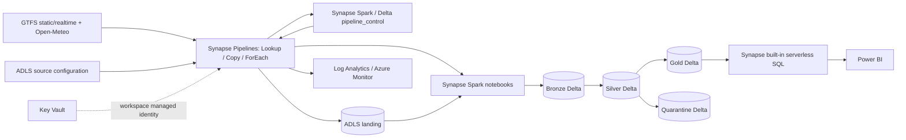

# Urban Mobility Reliability Analytics — Azure Synapse

One Synapse workspace manages **ingestion, scheduling, orchestration, Spark transformations, control
metadata and serverless SQL serving**. ADLS Gen2 stores data, Key Vault stores optional API credentials,
Azure Monitor handles alerts, and Power BI reports on Gold. No standalone Azure Data Factory, Azure SQL
control database, Databricks workspace or dedicated SQL pool is required.

Development: storage **dltmmobilitydev**, Synapse workspace **mobility-dev-syn-fxourtlytips4**, Spark pool
**mobilityspark**. Workspace names are derived from resource group/environment by Bicep in other installations.
Start with [the Synapse Studio walkthrough](docs/synapse-quickstart.md).



## Why consolidate? What does it cost?

The earlier design retained ADF because the original requirements explicitly requested `dftmprojects`.
Synapse Pipelines supports the activities this project uses, so a separate factory adds no required
capability here. Consolidation gives one authoring/monitoring workspace; it does **not** make pipeline
activity runs, Copy integration runtime, Spark or SQL scans free. An idle ADF resource is not a major
fixed-cost saving. Moving the mutable control table to Delta also removes the separate Azure SQL
Basic database's fixed charge, but adds Spark control-planning work per batch.

The largest cost risk remains frequent Spark work: a Small pool starts at three nodes. Keep the
five-minute trigger **stopped while learning**, run manual batches, and end idle sessions.
See [cost assumptions](docs/cost-estimate.md),
[Synapse feature differences](https://learn.microsoft.com/en-us/azure/synapse-analytics/data-integration/concepts-data-factory-differences),
and [Synapse pricing](https://azure.microsoft.com/en-us/pricing/details/synapse-analytics/).

## Run locally without Azure

Use Python 3.11 to match Synapse Spark 3.5; Python 3.12 also works for local tests.

```bash
python3.11 -m venv .venv
source .venv/bin/activate
pip install -e '.[dev]'
ruff check .
pytest -q
python scripts/validate_repo.py
python -m mobility.local --output .local
SOURCE_DATE_EPOCH=946684800 python -m build --wheel
az bicep build --file infra/main.bicep
```

Offline fixture: 19 raw envelopes, 18 valid deduplicated records, one invalid-latitude quarantine,
and four stop-event facts. It includes duplicate positions, an overnight trip, a cancellation,
one explicitly observed fixture arrival and a prediction.

For real local Spark/Delta tests (Java 17):

```bash
pip install -e '.[spark]'
SPARK_LOCAL_IP=127.0.0.1 PYSPARK_PYTHON="$PWD/.venv/bin/python" python scripts/spark_smoke.py
```

## Repository

| Path | Purpose |
|---|---|
| `infra/` | Bicep for Synapse, Spark pool, ADLS, Key Vault, identities, diagnostics and alerts |
| `synapse/pipelines/`, `datasets/`, `linkedServices/`, `triggers/` | Native Synapse orchestration artifacts |
| `synapse/notebooks/` | Parameterized Bronze, Silver, Gold, health and control notebooks |
| `synapse/config/pipeline_control.json` | Versioned configuration for five public example feeds |
| `synapse/libs/mobility/` | Shared parsing, validation, Delta and control logic |
| `synapse/tests/`, `scripts/spark_smoke.py` | Unit and distributed integration checks |
| `sql/control_tables/` | Spark SQL contract for the Delta control table |
| `sql/serving_views/` | Serverless T-SQL and separate Spark SQL views |
| `docs/`, `architecture/`, `powerbi/` | Operations, contracts, decisions and reporting guidance |

## Deployment

1. Configure Azure OIDC and GitHub `dev`/`prod` environments; require reviewers for prod.
2. Create a resource group and set SQL_ADMIN_OBJECT_ID/SQL_ADMIN_LOGIN to the Entra administrator group
   for Synapse's **serverless SQL endpoint**. They are not credentials for a separate SQL server.
3. Check storage, then deploy infrastructure:

```bash
az login
python scripts/preflight_infra.py --resource-group "$RESOURCE_GROUP"
az deployment group create -g "$RESOURCE_GROUP" --template-file infra/main.bicep \
  --parameters @infra/environments/dev.parameters.json \
  --parameters sqlAdminObjectId="$SQL_ADMIN_OBJECT_ID" sqlAdminLogin="$SQL_ADMIN_LOGIN" alertEmail="$ALERT_EMAIL"
```

   Existing untagged HNS accounts require reuseExistingStorage=true; project-managed HNS accounts
   can be redeployed normally. Non-HNS adoption requires a separately approved migration. Add approved
   administrator IPs via sqlAdminIps for Synapse Studio/API access. Use distinct names for production.
4. Wait for infrastructure/workspace state Succeeded. Set RESOURCE_GROUP, SYNAPSE_WORKSPACE,
   STORAGE_ACCOUNT, KEY_VAULT_URI, DATABASE_PREFIX and optionally SPARK_POOL as described in
   [the runbook](docs/runbook.md). The deployment identity needs Synapse artifact/package permissions
   and Blob Data Contributor on the landing container to publish configuration.
5. Build/upload the wheel, attach requirements to the **existing** pool, and import notebooks:

```bash
SOURCE_DATE_EPOCH=946684800 python -m build --wheel
python scripts/deploy_synapse.py
```

6. Publish metadata, linked services, datasets, child/master pipelines and the stopped trigger:

```bash
python scripts/deploy_synapse_pipelines.py
```

   CI runs both publish steps in order. The trigger is left stopped intentionally. Run a manual
   `MobilityMaster` batch with force=true, inspect Monitor and Delta reconciliation, then enable the
   trigger in Synapse Studio only if its cost and interval are appropriate.
7. Create a user database on the Synapse **built-in** SQL endpoint as its Entra administrator.
   Render and execute the T-SQL serving views in that user database:

```bash
python scripts/render_serverless_sql.py --storage dltmmobilitydev \
  --database-prefix mobility_dev --output .local/serverless_views.sql
```

8. Grant report identities SQL SELECT and Gold-container Blob Data Reader. Connect Power BI's Azure
   Synapse Analytics SQL connector to `<workspace>-ondemand.sql.azuresynapse.net` and that serving database.
   Execute [cloud acceptance checks](docs/test-plan.md) before operational use.

Infrastructure deployment does not execute Spark processing or publish Power BI reports. See
[validation evidence](docs/validation-results.md) for what has actually been tested.

## Metadata-driven ingestion

Lookup reads the versioned source JSON from `landing/<database_prefix>/config/pipeline_control.json`.
`mobility_control_plan` MERGEs configuration into `<prefix>_ops.pipeline_control`, preserves polling
progress, selects due sources and returns them to ForEach. Child pipelines fetch APIs using Copy and
optional Key Vault Web activity, then run Bronze/Silver and `mobility_control_commit`. Watermarks commit
only after Silver. Gold and health checks follow the source loop. No SQL control connection is used.
Supported UTC schedules: every five minutes, hourly and daily at 02:00. The scheduler is serialized;
manual replay must not run concurrently against the same prefix.

## Delta compatibility and metric semantics

Gold is checked for Delta reader 1/writer 2, classic checkpoints, no column mapping and no deletion
vectors, as required by Synapse serverless SQL. Do not enable advanced features on serving tables.
[Spark runtime](https://learn.microsoft.com/en-us/azure/synapse-analytics/spark/apache-spark-35-runtime),
[serverless limits](https://learn.microsoft.com/en-us/azure/synapse-analytics/sql/resources-self-help-sql-on-demand#serverless-support-delta-10-version).

Fact grain: source + trip + service date + stop sequence. GTFS schedules handle times beyond midnight
and DST. Missing updates are unknown, not cancellations. Standard GTFS-Realtime predicts arrivals;
actual-arrival KPIs stay null without a verified observation adapter. Predicted delays are separate.
On time means observed delay in [-1,+5] minutes. Cancellation rates use distinct reported trips.
Weather uses the closest available grid within 100 km at scheduled UTC hour, preferring archive data.
Trip vehicle counts and distance repeat on stop rows: do not sum them across stops.
See [contracts](architecture/data-contracts.md) and [limits](docs/limitations.md).

```sql
SELECT TOP 20 * FROM gold.v_route_reliability ORDER BY average_delay_minutes DESC;
SELECT * FROM gold.v_weather_impact WHERE weather_impact_index IS NOT NULL;
SELECT * FROM gold.v_trip_cancellation;
```

## Screenshots

Capture after real runs: Synapse Integrate pipelines, Develop notebooks, Monitor run history, Gold Delta
and built-in SQL results, Power BI overview and alert recovery. Store under docs/screenshots/ without secrets.
