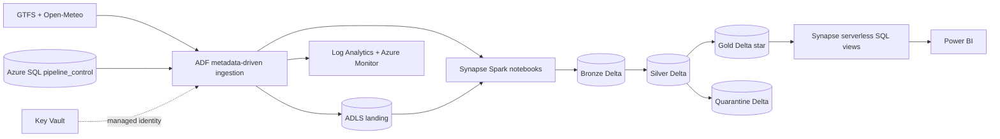

# Urban Mobility Reliability Analytics Platform

An Azure Synapse project for transit reliability analytics. Azure Data Factory **dftmprojects** polls
GTFS schedules, GTFS-Realtime and Open-Meteo weather. ADLS Gen2 **dltmprojects** stores landing →
Bronze Delta → Silver Delta → Gold Delta. **Synapse Spark** transforms the data, **Synapse serverless
SQL** serves it, and **Power BI** presents reliability metrics.

Start with [the Synapse Studio walkthrough](docs/synapse-quickstart.md) if Synapse is new to you.
No Databricks workspace, CLI, Unity Catalog or access connector is required.

## How the pieces fit



| Component | Responsibility |
|---|---|
| Data Factory | Read metadata, fetch feeds, run notebooks, commit polling watermarks |
| Azure SQL control database | Configuration and last successful source polling times |
| Synapse Spark pool `mobilityspark` | Execute PySpark normalization, validation, Delta MERGE and KPIs |
| Synapse serverless SQL | Query compatible Gold Delta files through T-SQL views; no dedicated SQL pool |
| ADLS / Key Vault / managed identities | Storage, secret management and authentication |
| Power BI | Reporting over the serverless SQL endpoint |

## Run without Azure

Python 3.11 is recommended to match Synapse Spark 3.5's Python runtime.

```bash
python3.11 -m venv .venv
source .venv/bin/activate
pip install -e '.[dev]'
ruff check .
pytest -q
python scripts/validate_repo.py
python -m mobility.local --output .local
SOURCE_DATE_EPOCH=946684800 python -m build --wheel
az bicep build --file infra/main.bicep
```

The fixture includes a duplicate position, invalid latitude, cancellation, overnight service time,
one explicitly observed arrival and a prediction. Expected result: 19 raw envelopes, 18 valid
deduplicated records, 1 quarantine, and 4 stop-event facts. The observed flag is a fixture extension,
not a guarantee from standard GTFS-Realtime.

Optional real Spark/Delta tests (Java 17 required):

```bash
pip install -e '.[spark]'
SPARK_LOCAL_IP=127.0.0.1 PYSPARK_PYTHON="$PWD/.venv/bin/python" python scripts/spark_smoke.py
```

## Repository

| Directory | Content |
|---|---|
| `infra/` | Bicep workspace, Spark pool, storage, SQL control, Key Vault, identities, alerts |
| `datafactory/` | Parameterized pipelines, datasets, linked services, triggers and ARM export |
| `synapse/notebooks/` | Importable `.ipynb` notebooks with tagged parameter cells |
| `synapse/libs/mobility/` | Shared Python/PySpark transformations and checks |
| `synapse/tests/` | Offline tests; `scripts/spark_smoke.py` adds Delta integration |
| `sql/control_tables/` | Azure SQL control migrations and public sample metadata |
| `sql/serving_views/` | Serverless T-SQL views and separate Spark SQL views |
| `architecture/`, `docs/`, `powerbi/` | Contracts, decisions, deployment/recovery, costs and report model |

## Deploy in order

1. Create an Azure resource group and GitHub `dev` / `prod` environments. Configure Azure OIDC;
   set **required reviewers for prod** in GitHub. See [runbook variables](docs/runbook.md).
2. Deploy infrastructure:

```bash
az login
az deployment group create -g "$RESOURCE_GROUP" --template-file infra/main.bicep \
  --parameters @infra/environments/dev.parameters.json \
  --parameters sqlAdminObjectId="$SQL_ADMIN_OBJECT_ID" sqlAdminLogin="$SQL_ADMIN_LOGIN" alertEmail="$ALERT_EMAIL"
```

   Add your fixed egress IP through `sqlAdminIps` for SQL/Synapse administration. Workspace SQL access
   is Entra-only. There is no dedicated SQL pool or Databricks resource.
3. As the Azure SQL Entra administrator, install `azure-identity`, `pyodbc` and ODBC Driver 18, then:

```bash
python scripts/bootstrap_sql.py --server "$SQL_SERVER"
```

   Seeds use public MBTA schedules/realtime and Boston weather. Keep all GTFS feeds under one provider
   namespace; edit source metadata to choose another provider/city.
4. As a Synapse Administrator, grant ADF the notebook execution roles:

```bash
export SYNAPSE_WORKSPACE ADF_PRINCIPAL_ID
bash scripts/bootstrap_synapse.sh
```

5. Build the library, upload it to Synapse, attach it to the pool, and import notebooks:

```bash
export RESOURCE_GROUP SYNAPSE_WORKSPACE
export SPARK_POOL=mobilityspark
SOURCE_DATE_EPOCH=946684800 python -m build --wheel
python scripts/deploy_synapse.py
```

   Use a new package version for each library release and start new sessions after pool updates.
6. Run the ADF publishing/deployment workflow. Supply Synapse endpoint/resource ID and `DATABASE_PREFIX`
   instead of any Databricks settings. Force the first master run to load all sources. Inspect Spark
   tables such as `mobility_dev_gold.fact_trip_performance`.
7. In Synapse Studio's **built-in** SQL endpoint, create a user database (e.g. `mobility_dev_serving`)
   as the Entra administrator. Render the serverless views and execute them **in that database**:

```bash
python scripts/render_serverless_sql.py --storage dltmprojects \
  --database-prefix mobility_dev --output .local/serverless_views.sql
```

   Grant report identities SQL SELECT and Storage Blob Data Reader on the Gold container. These views
   use Entra pass-through to ADLS; no SAS, SQL password or storage credential is embedded.
8. Connect Power BI's Azure Synapse Analytics SQL connector to
   `<workspace>-ondemand.sql.azuresynapse.net`, selecting the serving database. Follow [Power BI setup](powerbi/README.md).
   Run [Azure acceptance checks](docs/test-plan.md) before operational use.

**Exact-name constraint:** `dltmprojects` is globally unique. Dev and prod parameter files are alternative
installations, not two simultaneously deployable lakes with the same name. Use one environment at a time
or approve different names for isolation. Do not point a prod deployment at dev's resource group.

## Delta and SQL compatibility

Synapse Spark 3.5 includes Delta 3.2. Serverless SQL supports Delta reader protocol 1 and does not support
features such as deletion vectors or column mapping. The library explicitly writes reader **1** / writer
**2**, disables those features, uses classic checkpoints, and checks every Gold table's protocol after a
build. Never enable a newer table feature on a serving table without reviewing compatibility.
[Spark runtime](https://learn.microsoft.com/en-us/azure/synapse-analytics/spark/apache-spark-35-runtime),
[serverless limitations](https://learn.microsoft.com/en-us/azure/synapse-analytics/sql/resources-self-help-sql-on-demand#serverless-support-delta-10-version).

## Metrics and boundaries

Fact grain: source + trip + service date + stop sequence. UTC schedules handle GTFS times beyond 24:00.
Cancellation requires explicit CANCELED; missing realtime data remains unknown. Standard GTFS-Realtime
usually predicts arrivals, so actual-arrival KPIs stay null until a verified observation source is supplied.
Prediction columns and predicted delay remain available for operational analysis. On-time means an observed
delay from -1 to +5 minutes. Cancellation rate uses distinct reported trips, not all scheduled service.
Weather joins the closest available grid within 100 km at scheduled UTC hour, preferring historical weather.
Distance and vehicle count are trip-level values repeated on stop rows: do not sum them across stops.
See [contracts](architecture/data-contracts.md) and [limitations](docs/limitations.md).

## Example serverless queries

```sql
SELECT TOP 20 route_short_name, weekday, [hour], average_delay_minutes, on_time_performance_pct
FROM gold.v_route_reliability ORDER BY average_delay_minutes DESC;
SELECT * FROM gold.v_weather_impact WHERE weather_impact_index IS NOT NULL;
SELECT * FROM gold.v_trip_cancellation;
```

## CI/CD and verification

PR checks run Ruff, unit tests, notebook syntax/reference validation, Bicep compilation and Microsoft's
ADF validator. `synapse-ci.yml` adds a real Spark/Delta integration test, builds the wheel, and deploys
pool packages/notebooks through Azure CLI. ADF ARM artifacts are exported from main. Dev deploys on
relevant merges; prod uses manual dispatch and the protected GitHub environment.
First installation must follow the dependency order above; pause/drain ingestion during package updates.
[Validation evidence](docs/validation-results.md) distinguishes local tests from cloud acceptance.

## Screenshot placeholders

After a real deployment, add screenshots under `docs/screenshots/`: successful ADF run, Synapse notebooks,
Spark Gold tables, built-in SQL query, Power BI reliability overview and alert recovery. No fabricated images.
