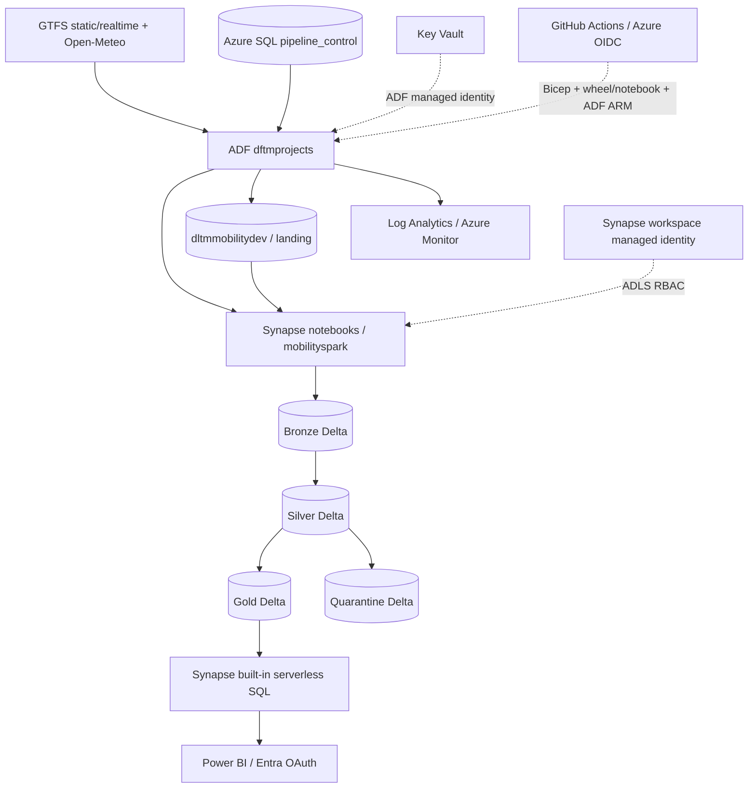

# Synapse architecture

The workspace has a three-node Small Spark pool with auto-pause and a built-in SQL endpoint. There is
no dedicated SQL pool. Spark writes protocol-compatible Delta; serverless views use Entra pass-through.
The `synapse` filesystem supports workspace operations; medallion data stays in separate named containers.
